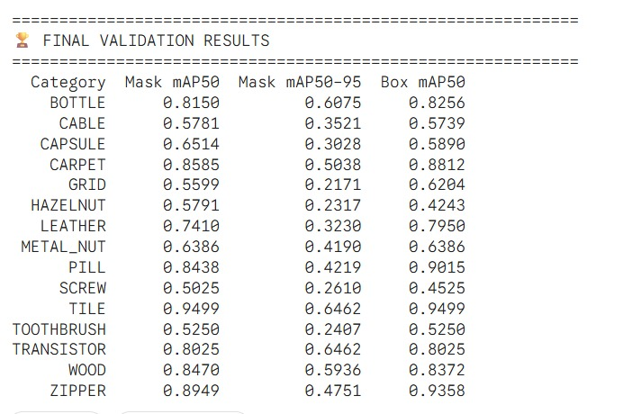

# Defect Classifications

Deep learning-based defect classification and segmentation models trained on the **MVTec Anomaly Detection (AD)** dataset across 15 categories, optimized for edge AI acceleration on the **Raspberry Pi AI HAT+** (Hailo-8 / Hailo-8L).

---

## Repository Structure

```text
Defect-classifications/
├── full_training/                # Production models for all 15 categories (*_production_best.pt, 100 epochs, early stopping)
├── rapid_training/               # Baseline models for all 15 categories (*_best.pt, 40 epochs)
├── full_training_result.jpeg     # Validation and performance summary for full_training
├── HAT+ quatization/             # Hailo AI HAT+ quantization and HEF compilation tools
│   ├── compile_hef.py            # Python compiler script (YOLO .pt -> Hailo .hef)
│   ├── run_compiler.sh           # Dockerized runner bridging host to Ubuntu 22.04 runtime
│   ├── hailo_cli.sh              # Hailo CLI wrapper tool
│   ├── README.md                 # Detailed compilation & deployment guide
│   └── hef_output/               # Compiled Hailo Executable Format (.hef) binaries
├── pi_deployment/                # Pure HailoRT edge deployment package for Raspberry Pi 5
│   ├── models/                   # Target HEF models and metadata (tile_hailo8.hef, metadata.yaml)
│   ├── dataset/                  # Validation images and ground-truth polygon labels
│   ├── sample_images/            # Test images for instant verification
│   ├── results/                  # Inference output directory (annotated images & reports)
│   ├── inference.py              # Pure Native HailoRT inference engine (HUD, masks, JSON logs)
│   ├── evaluate_hef.py           # On-device Box & Mask mAP evaluation script
│   ├── run_eval.sh               # 1-click mAP and accuracy evaluation runner
│   ├── run_inference.sh          # 1-click test runner (images, live camera, benchmark)
│   ├── setup_pi.sh               # 1-click Raspberry Pi OS setup script (~30 sec)
│   └── README.md                 # Comprehensive deployment & evaluation guide
└── README.md
```

---

## Model Training Configurations

### 1. Full Training (`full_training/`)
* **Epochs:** 100 epochs with **Early Stopping**.
* **Augmentation:** Configured with **higher level data augmentation** (rotation, scaling, color jitter, flip) to improve model generalization and robustness against noisy industrial environments.
* **Checkpoint Naming:** Saved as `<category>_production_best.pt`.
* **Categories (15):** `bottle`, `cable`, `capsule`, `carpet`, `grid`, `hazelnut`, `leather`, `metal_nut`, `pill`, `screw`, `tile`, `toothbrush`, `transistor`, `wood`, `zipper`.

### 2. Rapid Training (`rapid_training/`)
* **Epochs:** 40 epochs.
* **Augmentation:** Standardized baseline with the **same level of augmentation across all models**.
* **Checkpoint Naming:** Saved as `<category>_best.pt`.

---

## Training Results

The evaluation metrics and benchmark results from the `full_training` run are captured below:



---

## Hardware Acceleration & Model Quantization (`HAT+ quatization/`)

This directory contains the compilation toolchain to quantize and compile PyTorch weights (`.pt`) into Hailo Executable Format (`.hef`) for edge inference on the **Raspberry Pi 5 with AI HAT+**.

### Supported Hardware Targets:
* **Hailo-8 (26 TOPS):** Target `--arch hailo8`
* **Hailo-8L (13 TOPS):** Target `--arch hailo8l`

### Compilation Commands:
```bash
cd "HAT+ quatization"

# Compile a single category (e.g. tile for Hailo-8)
./run_compiler.sh --category tile --arch hailo8

# Compile for 13 TOPS HAT+ (Hailo-8L)
./run_compiler.sh --category tile --arch hailo8l

# Fast Post-Training Quantization (~1.5 min)
./run_compiler.sh --category tile --arch hailo8 --fast

# Batch compile all 15 categories
./run_compiler.sh --all --arch hailo8
```

Pre-compiled `.hef` binaries are available in `HAT+ quatization/hef_output/`. See [`HAT+ quatization/README.md`](HAT+%20quatization/README.md) for full details.

---

## Raspberry Pi 5 Deployment (`pi_deployment/`)

A standalone, lightweight deployment package designed to run on a **Raspberry Pi 5** equipped with the **Raspberry Pi AI HAT+ (26 TOPS Hailo-8 / 13 TOPS Hailo-8L)**.

### Key Highlights:
* **Pure Native HailoRT Runtime (`hailo_platform`)**: Zero PyTorch or Ultralytics dependencies required on the Raspberry Pi. Runs using only Native HailoRT, NumPy, and OpenCV.
* **High Efficiency**: Hardware-accelerated inference (~11.6 ms latency / ~85+ FPS) with low power consumption.
* **On-Board Accuracy & mAP Validation**: Includes scripts to compute Box mAP50, Box mAP50-95, Mask mAP50, Mask mAP50-95, and industrial pass/fail classification accuracy directly on edge hardware.

### Quick Deployment Steps:

1. **Transfer the package to your Raspberry Pi 5:**
   ```bash
   scp -r pi_deployment <pi_user>@<pi_ip>:~/
   ```

2. **One-click setup on the Raspberry Pi:**
   ```bash
   cd ~/pi_deployment
   chmod +x setup_pi.sh run_inference.sh inference.py evaluate_hef.py run_eval.sh
   ./setup_pi.sh
   ```
   *(Installs official `hailo-all` drivers, enables PCIe Gen 3 bus, and configures python dependencies in ~30 seconds).*

3. **Run Defect Inspection & Benchmark:**
   ```bash
   # Run inference on sample images:
   ./run_inference.sh

   # Stream from connected USB/CSI camera:
   ./run_inference.sh --camera

   # Benchmark hardware latency & throughput:
   ./run_inference.sh --benchmark
   ```

4. **Run On-Device Accuracy & mAP Evaluation:**
   ```bash
   # Evaluates mAP and confusion metrics against dataset/
   ./run_eval.sh
   ```

Full details and configuration options are documented in [`pi_deployment/README.md`](pi_deployment/README.md).
